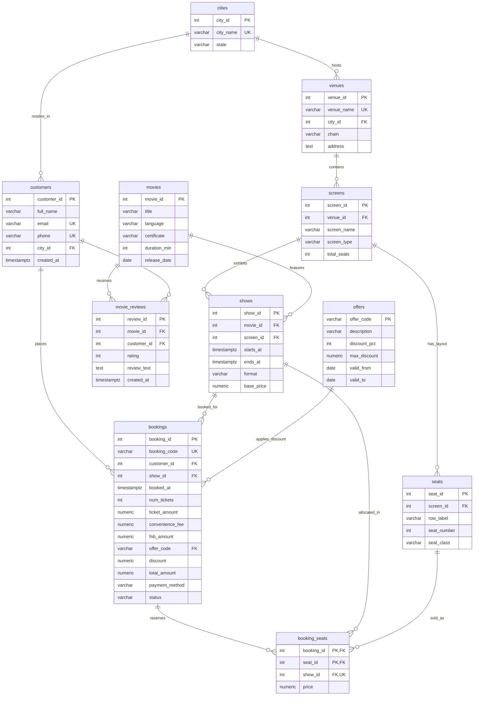

# Phase 2: Relational Schema Design & Data Loading Report
**Project:** BookMyShow Movie & Event Ticketing Database (DBMS Project 2026)  
**Team:** T0052 · **Section:** A · **Database:** PostgreSQL 16+  
**Scope:** Phase 2 Deliverable (`docs/02_schema_design.md`)

---

## 1. Overview of Database Architecture

The BookMyShow relational schema models an enterprise movie-ticketing platform designed in PostgreSQL. It is structured into three logical operational tiers:
1. **Physical Cinema Infrastructure:** `cities`, `venues`, `screens`, `seats`.
2. **Catalog & Show Scheduling:** `movies`, `shows`.
3. **Transaction & User Interactions:** `customers`, `offers`, `bookings`, `booking_seats`, `movie_reviews`.

All tables reside within the dedicated namespace schema **`bms`**. The architecture enforces strict entity integrity, domain constraints, referential integrity with explicit cascade/restrict rules, and an advanced exclusion constraint using `btree_gist` to eliminate temporal screening overlaps.

---

## 2. Entity-Relationship (ER) Model



---

## 3. Data Dictionary

### 3.1 `cities`
| Column Name | Data Type | Nullable | Constraint | Justification & Purpose |
|---|---|:---:|---|---|
| `city_id` | `INT` | NO | `PRIMARY KEY`, `> 0` | Surrogate identifier for operational cities. |
| `city_name` | `VARCHAR(50)` | NO | `UNIQUE` | Human-readable city name (e.g., Bengaluru, Mumbai). |
| `state` | `VARCHAR(50)` | NO | — | Geographic state (e.g., Karnataka, Maharashtra). |

### 3.2 `venues`
| Column Name | Data Type | Nullable | Constraint | Justification & Purpose |
|---|---|:---:|---|---|
| `venue_id` | `INT` | NO | `PRIMARY KEY`, `> 0` | Surrogate identifier for cinema venues. |
| `venue_name` | `VARCHAR(100)` | NO | `UNIQUE` | Distinct commercial cinema venue name. |
| `city_id` | `INT` | NO | `FK -> cities(city_id) RESTRICT` | Geographic city location of the theatre. |
| `chain` | `VARCHAR(50)` | NO | `IN ('Cinepolis', 'INOX', 'Independent', 'Miraj', 'PVR')` | Cinema operating brand/chain. |
| `address` | `TEXT` | NO | — | Street address or landmark of the venue. |

### 3.3 `screens`
| Column Name | Data Type | Nullable | Constraint | Justification & Purpose |
|---|---|:---:|---|---|
| `screen_id` | `INT` | NO | `PRIMARY KEY`, `> 0` | Unique identifier for each physical auditorium. |
| `venue_id` | `INT` | NO | `FK -> venues(venue_id) CASCADE` | The cinema venue housing this auditorium. |
| `screen_name` | `VARCHAR(50)` | NO | `UNIQUE(venue_id, screen_name)` | Local auditorium name (Audi 1, Audi 2). |
| `screen_type` | `VARCHAR(20)` | NO | `IN ('4DX', 'GOLD', 'IMAX', 'STANDARD')` | Projection format capabilities. |
| `total_seats` | `INT` | NO | `> 0` | Total physical seat capacity. |

### 3.4 `seats`
| Column Name | Data Type | Nullable | Constraint | Justification & Purpose |
|---|---|:---:|---|---|
| `seat_id` | `INT` | NO | `PRIMARY KEY`, `> 0` | Global surrogate primary key for physical seats. |
| `screen_id` | `INT` | NO | `FK -> screens(screen_id) CASCADE` | Auditorium containing this seat. |
| `row_label` | `VARCHAR(5)` | NO | `~ '^[A-Z]+$'` | Row letter code (A, B, C, ...). |
| `seat_number` | `INT` | NO | `> 0` | Number of seat along the row (1, 2, ...). |
| `seat_class` | `VARCHAR(20)` | NO | `IN ('CLASSIC', 'PRIME', 'RECLINER')` | Pricing and seating luxury tier. |
| *(Composite)* | — | — | `UNIQUE(screen_id, row_label, seat_number)` | Prevents duplicate coordinates inside any auditorium. |

### 3.5 `movies`
| Column Name | Data Type | Nullable | Constraint | Justification & Purpose |
|---|---|:---:|---|---|
| `movie_id` | `INT` | NO | `PRIMARY KEY`, `> 0` | Film catalog surrogate identifier. |
| `title` | `VARCHAR(200)` | NO | — | Official film title. |
| `language` | `VARCHAR(50)` | NO | `IN ('Bengali', 'English', 'Hindi', ...)` | Spoken audio track / language of film. |
| `certificate` | `VARCHAR(10)` | NO | `IN ('A', 'U', 'UA')` | CBFC rating certification. |
| `duration_min` | `INT` | NO | `> 0` | Runtime in minutes (used for turnaround scheduling). |
| `release_date` | `DATE` | NO | — | Theatrical release date. |

### 3.6 `shows`
| Column Name | Data Type | Nullable | Constraint | Justification & Purpose |
|---|---|:---:|---|---|
| `show_id` | `INT` | NO | `PRIMARY KEY`, `> 0` | Screening event identifier. |
| `movie_id` | `INT` | NO | `FK -> movies(movie_id) RESTRICT` | Film scheduled to be screened. |
| `screen_id` | `INT` | NO | `FK -> screens(screen_id) RESTRICT` | Auditorium where show takes place. |
| `starts_at` | `TIMESTAMPTZ` | NO | — | Scheduled screening start timestamp (IST offset). |
| `ends_at` | `TIMESTAMPTZ` | NO | `ends_at > starts_at` | Scheduled screening end timestamp. |
| `format` | `VARCHAR(10)` | NO | `IN ('2D', '3D', '4DX', 'IMAX')` | Projection standard for this show. |
| `base_price` | `NUMERIC(8,2)` | NO | `> 0` | Base ticket price before tier modifiers. |
| *(Exclusion)* | — | — | `EXCLUDE USING gist (screen_id WITH =, tstzrange(starts_at, ends_at, '[)') WITH &&)` | Enforces that no two shows overlap on the same screen. |

### 3.7 `customers`
| Column Name | Data Type | Nullable | Constraint | Justification & Purpose |
|---|---|:---:|---|---|
| `customer_id` | `INT` | NO | `PRIMARY KEY`, `> 0` | Registered user account identifier. |
| `full_name` | `VARCHAR(100)` | NO | — | User's full legal name. |
| `email` | `VARCHAR(100)` | NO | `UNIQUE`, regex format | Unique contact and login identifier. |
| `phone` | `VARCHAR(15)` | NO | `UNIQUE`, `~ '^[0-9]{10}$'` | 10-digit mobile number for SMS/sign-in. |
| `city_id` | `INT` | NO | `FK -> cities(city_id) RESTRICT` | Customer's primary home city. |
| `created_at` | `TIMESTAMPTZ` | NO | — | Account registration timestamp. |

### 3.8 `offers`
| Column Name | Data Type | Nullable | Constraint | Justification & Purpose |
|---|---|:---:|---|---|
| `offer_code` | `VARCHAR(20)` | NO | `PRIMARY KEY` | Alphanumeric promotional coupon code. |
| `description` | `VARCHAR(100)` | NO | — | Promotional terms (e.g., 'Buy one get one'). |
| `discount_pct` | `INT` | NO | `BETWEEN 1 AND 100` | Percentage discount applied on ticket price. |
| `max_discount` | `NUMERIC(8,2)` | NO | `> 0` | Upper monetary cap on discount amount. |
| `valid_from` | `DATE` | NO | — | Campaign start date. |
| `valid_to` | `DATE` | NO | `valid_to >= valid_from` | Campaign expiry date. |

### 3.9 `bookings`
| Column Name | Data Type | Nullable | Constraint | Justification & Purpose |
|---|---|:---:|---|---|
| `booking_id` | `INT` | NO | `PRIMARY KEY`, `> 0` | Transaction record surrogate ID. |
| `booking_code` | `VARCHAR(12)` | NO | `UNIQUE`, `~ '^BMS[0-9A-F]{7}$'` | Alphanumeric confirmation code shown to user. |
| `customer_id` | `INT` | NO | `FK -> customers(customer_id) RESTRICT` | Customer who placed the booking. |
| `show_id` | `INT` | NO | `FK -> shows(show_id) RESTRICT` | Show being booked. |
| `booked_at` | `TIMESTAMPTZ` | NO | — | Timestamp when transaction was initiated. |
| `num_tickets` | `INT` | NO | `> 0` | Total number of seats reserved. |
| `ticket_amount` | `NUMERIC(8,2)` | NO | `>= 0` | Subtotal sum of seat prices. |
| `convenience_fee`| `NUMERIC(8,2)` | NO | `>= 0` | BookMyShow service charge. |
| `fnb_amount` | `NUMERIC(8,2)` | NO | `>= 0`, `DEFAULT 0.00` | Optional food and beverages subtotal. |
| `offer_code` | `VARCHAR(20)` | YES | `FK -> offers(offer_code) SET NULL` | Applied voucher (NULL if no offer used). |
| `discount` | `NUMERIC(8,2)` | NO | `>= 0`, `DEFAULT 0.00` | Value deducted by promotional offer. |
| `total_amount` | `NUMERIC(8,2)` | NO | `>= 0`, `CHECK (total_amount = ticket_amount + convenience_fee + fnb_amount - discount)` | Net payable amount charged to customer. |
| `payment_method`| `VARCHAR(20)` | NO | `IN ('CARD', 'GIFT_CARD', 'NETBANKING', 'UPI', 'WALLET')` | Gateway instrument used. |
| `status` | `VARCHAR(20)` | NO | `IN ('CANCELLED', 'CONFIRMED', 'PAYMENT_FAILED', 'PENDING')` | Transaction lifecycle state. |

### 3.10 `booking_seats`
| Column Name | Data Type | Nullable | Constraint | Justification & Purpose |
|---|---|:---:|---|---|
| `booking_id` | `INT` | NO | `PK`, `FK -> bookings(booking_id) CASCADE` | Booking transaction holding this seat. |
| `seat_id` | `INT` | NO | `PK`, `FK -> seats(seat_id) RESTRICT` | Physical seat reserved. |
| `show_id` | `INT` | NO | `FK -> shows(show_id) RESTRICT` | Redundant show ID for fast lookups & constraint. |
| `price` | `NUMERIC(8,2)` | NO | `> 0` | Price charged for this specific seat. |
| *(Double Booking Invariant)* | — | — | `UNIQUE(show_id, seat_id)` | **CRITICAL:** Prevents the same physical seat from being booked twice for the same show; supports `ON CONFLICT (show_id, seat_id)`. |

### 3.11 `movie_reviews`
| Column Name | Data Type | Nullable | Constraint | Justification & Purpose |
|---|---|:---:|---|---|
| `review_id` | `INT` | NO | `PRIMARY KEY`, `> 0` | Review surrogate identifier. |
| `movie_id` | `INT` | NO | `FK -> movies(movie_id) CASCADE` | Film being evaluated. |
| `customer_id` | `INT` | NO | `FK -> customers(customer_id) RESTRICT` | User submitting the review. |
| `rating` | `INT` | NO | `BETWEEN 1 AND 10` | Numerical score (1 to 10). |
| `review_text` | `TEXT` | YES | — | Optional written commentary (NULL allowed). |
| `created_at` | `TIMESTAMPTZ` | NO | — | Submission timestamp. |
| *(Composite)* | — | — | `UNIQUE(movie_id, customer_id)` | Restricts each user to at most 1 review per movie. |

---

## 4. Referential Integrity & Relationship Matrix

| Parent Table | Child Table | Foreign Key Column | Referenced Column | Cardinality | ON DELETE Action | Business Justification |
|---|---|---|---|:---:|---|---|
| `cities` | `venues` | `city_id` | `city_id` | 1 : N | `RESTRICT` | Cannot delete a city while active cinema venues exist in it. |
| `cities` | `customers` | `city_id` | `city_id` | 1 : N | `RESTRICT` | Cannot delete a city while customers are registered under it. |
| `venues` | `screens` | `venue_id` | `venue_id` | 1 : N | `CASCADE` | If a venue is demolished/decommissioned, its screens are removed. |
| `screens` | `seats` | `screen_id` | `screen_id` | 1 : N | `CASCADE` | Removing an auditorium removes its internal seat layout. |
| `screens` | `shows` | `screen_id` | `screen_id` | 1 : N | `RESTRICT` | Cannot delete an auditorium that has scheduled shows. |
| `movies` | `shows` | `movie_id` | `movie_id` | 1 : N | `RESTRICT` | Cannot delete a film title that has active scheduled screenings. |
| `movies` | `movie_reviews`| `movie_id` | `movie_id` | 1 : N | `CASCADE` | If a movie is purged from catalog, its user reviews are removed. |
| `customers` | `bookings` | `customer_id` | `customer_id` | 1 : N | `RESTRICT` | Preserves audit trails and financial accounting records. |
| `customers` | `movie_reviews`| `customer_id` | `customer_id` | 1 : N | `RESTRICT` | Cannot delete a user while their authored reviews persist. |
| `shows` | `bookings` | `show_id` | `show_id` | 1 : N | `RESTRICT` | Cannot drop a screening event with tickets sold or pending. |
| `offers` | `bookings` | `offer_code` | `offer_code` | 1 : N | `SET NULL` | Retiring a discount voucher leaves historical bookings intact. |
| `bookings` | `booking_seats`| `booking_id` | `booking_id` | 1 : N | `CASCADE` | If a booking is deleted or released, its seat allocations are cleared. |
| `shows` | `booking_seats`| `show_id` | `show_id` | 1 : N | `RESTRICT` | Cannot delete a show while seat allocations exist. |
| `seats` | `booking_seats`| `seat_id` | `seat_id` | 1 : N | `RESTRICT` | Cannot delete a physical seat with historical booking logs. |

---

## 5. Functional Dependencies & Normalization Analysis

Every table was analyzed against functional dependencies to confirm 3NF and BCNF compliance.

### 5.1 Analysis by Table
1. **`cities`**:
   - Primary Key: `city_id`
   - Functional Dependencies: `city_id -> city_name, state`; `city_name -> city_id, state`.
   - Normal Form: **BCNF** (All determinants are candidate keys).
2. **`venues`**:
   - Primary Key: `venue_id`
   - Functional Dependencies: `venue_id -> venue_name, city_id, chain, address`; `venue_name -> venue_id, city_id, chain, address`.
   - Normal Form: **BCNF**.
3. **`screens`**:
   - Primary Key: `screen_id`
   - Candidate Keys: `screen_id`, `{venue_id, screen_name}`
   - Functional Dependencies: `screen_id -> venue_id, screen_name, screen_type, total_seats`.
   - Normal Form: **BCNF**.
4. **`seats`**:
   - Primary Key: `seat_id`
   - Candidate Keys: `seat_id`, `{screen_id, row_label, seat_number}`
   - Functional Dependencies: `seat_id -> screen_id, row_label, seat_number, seat_class`.
   - Normal Form: **BCNF**.
5. **`movies`**:
   - Primary Key: `movie_id`
   - Functional Dependencies: `movie_id -> title, language, certificate, duration_min, release_date`.
   - Normal Form: **BCNF**.
6. **`shows`**:
   - Primary Key: `show_id`
   - Functional Dependencies: `show_id -> movie_id, screen_id, starts_at, ends_at, format, base_price`.
   - Normal Form: **BCNF**.
7. **`customers`**:
   - Primary Key: `customer_id`
   - Candidate Keys: `customer_id`, `email`, `phone`
   - Functional Dependencies: `customer_id -> full_name, email, phone, city_id, created_at`.
   - Normal Form: **BCNF**.
8. **`offers`**:
   - Primary Key: `offer_code`
   - Functional Dependencies: `offer_code -> description, discount_pct, max_discount, valid_from, valid_to`.
   - Normal Form: **BCNF**.
9. **`bookings`**:
   - Primary Key: `booking_id`
   - Candidate Keys: `booking_id`, `booking_code`
   - Functional Dependencies: `booking_id -> booking_code, customer_id, show_id, booked_at, num_tickets, ticket_amount, convenience_fee, fnb_amount, offer_code, discount, total_amount, payment_method, status`.
   - Normal Form: **BCNF**.
10. **`booking_seats`**:
    - Candidate Keys: `{booking_id, seat_id}`, `{show_id, seat_id}`
    - Functional Dependencies: `{booking_id, seat_id} -> show_id, price`; `{show_id, seat_id} -> booking_id, price`.
    - Normal Form: **BCNF** (All determinants are superkeys).
11. **`movie_reviews`**:
    - Primary Key: `review_id`
    - Candidate Keys: `review_id`, `{movie_id, customer_id}`
    - Functional Dependencies: `review_id -> movie_id, customer_id, rating, review_text, created_at`.
    - Normal Form: **BCNF**.

### 5.2 Controlled Redundancy & Derived Columns Justification
The seed data includes intentional denormalization points that serve vital performance and transactional purposes:
1. **`screens.total_seats` vs `COUNT(seats)`:**
   - *Status:* Derived from physical seat count.
   - *Justification:* During real-time occupancy checks (e.g., `R07`, `R25`), computing `COUNT(*)` over 94k seats requires an expensive join and aggregation. Storing `total_seats` allows $O(1)$ capacity lookup. Our integrity check confirms $0$ discrepancies.
2. **`bookings.ticket_amount` vs `SUM(booking_seats.price)`:**
   - *Status:* Derived aggregation.
   - *Justification:* In e-commerce checkout, financial immutability is essential. The booking invoice must preserve the historical transaction amount even if individual seat prices change in the future.
3. **`booking_seats.show_id` vs `bookings.show_id`:**
   - *Status:* Transitively redundant via `booking_id -> show_id`.
   - *Justification:* Necessary to enforce the **No-Double-Booking Invariant** via `UNIQUE (show_id, seat_id)`. Without `show_id` in `booking_seats`, enforcing that a seat is not sold twice across different bookings for the same show would require a complex subquery trigger or full table scan.
4. **`shows.ends_at` vs `shows.starts_at + movies.duration_min`:**
   - *Status:* Derived timestamp.
   - *Justification:* Theatrical end times include trailers, national anthems, and intermission buffers. Storing explicit `ends_at` allows PostgreSQL's `EXCLUDE USING gist` to perform instantaneous temporal overlap checks.

---

## 6. Data Loading & Verification

### 6.1 Dependency-Safe Loading Order
To satisfy all foreign-key constraints without temporary constraint disabling, tables must be loaded in the following strict topological order:
1. `cities` (Independent root)
2. `venues` (Depends on `cities`)
3. `screens` (Depends on `venues`)
4. `seats` (Depends on `screens`)
5. `movies` (Independent catalog)
6. `shows` (Depends on `movies`, `screens`)
7. `customers` (Depends on `cities`)
8. `offers` (Independent voucher catalog)
9. `bookings` (Depends on `customers`, `shows`, `offers`)
10. `booking_seats` (Depends on `bookings`, `shows`, `seats`)
11. `movie_reviews` (Depends on `movies`, `customers`)

### 6.2 Seed Data Verification Results
Execution of `sql/02_load_data.sql` was verified directly on the database `bookmyshow_db` under schema `bms`.

| Table Name | Source CSV File | Expected Row Count | Database Ingested Count | Match Status |
|---|---|:---:|:---:|:---:|
| `cities` | `seed_data/cities.csv` | 10 | 10 | ✅ Exact Match |
| `venues` | `seed_data/venues.csv` | 140 | 140 | ✅ Exact Match |
| `screens` | `seed_data/screens.csv` | 490 | 490 | ✅ Exact Match |
| `seats` | `seed_data/seats.csv` | 94,056 | 94,056 | ✅ Exact Match |
| `movies` | `seed_data/movies.csv` | 300 | 300 | ✅ Exact Match |
| `shows` | `seed_data/shows.csv` | 160,034 | 160,034 | ✅ Exact Match |
| `customers` | `seed_data/customers.csv` | 40,000 | 40,000 | ✅ Exact Match |
| `offers` | `seed_data/offers.csv` | 25 | 25 | ✅ Exact Match |
| `bookings` | `seed_data/bookings.csv` | 150,094 | 150,094 | ✅ Exact Match |
| `booking_seats` | `seed_data/booking_seats.csv` | 300,389 | 300,389 | ✅ Exact Match |
| `movie_reviews` | `seed_data/movie_reviews.csv` | 32,510 | 32,510 | ✅ Exact Match |
| **Total** | **11 Files** | **778,048** | **778,048** | **100% Ingested** |

---

## 7. Integrity Verification Suite (5 Custom Checks)

Following data ingestion, 5 deep relational and business integrity verification queries were executed against `bms`:

```sql
SET search_path TO bms;

-- 1. Verify every booked seat belongs to the exact screen hosting that show
SELECT count(*) AS mismatched_screen_seats
FROM booking_seats bs
JOIN shows s ON s.show_id = bs.show_id
JOIN seats se ON se.seat_id = bs.seat_id
WHERE s.screen_id <> se.screen_id;
-- Result: 0 (Zero mismatched seats)

-- 2. Verify active bookings hold the exact number of seats declared in num_tickets
SELECT count(*) AS mismatched_ticket_counts
FROM bookings b
LEFT JOIN (
    SELECT booking_id, count(*) AS actual_seats
    FROM booking_seats
    GROUP BY booking_id
) bs ON bs.booking_id = b.booking_id
WHERE b.status IN ('CONFIRMED', 'PENDING')
  AND b.num_tickets <> COALESCE(bs.actual_seats, 0);
-- Result: 0 (Exact ticket-to-seat correspondence)

-- 3. Verify cancelled or failed bookings do NOT hold active seat locks
SELECT count(*) AS orphaned_cancelled_seats
FROM bookings b
JOIN booking_seats bs ON bs.booking_id = b.booking_id
WHERE b.status IN ('CANCELLED', 'PAYMENT_FAILED');
-- Result: 0 (All 300,389 allocated seats belong strictly to CONFIRMED or PENDING orders)

-- 4. Verify screens.total_seats perfectly matches physical seat layout count
SELECT count(*) AS screen_seat_discrepancies
FROM screens sc
JOIN (
    SELECT screen_id, count(*) AS seat_count
    FROM seats
    GROUP BY screen_id
) s ON s.screen_id = sc.screen_id
WHERE sc.total_seats <> s.seat_count;
-- Result: 0 (Every auditorium capacity is 100% consistent with physical rows/seats)

-- 5. Verify mathematical precision of booking total amounts
SELECT count(*) AS bad_total_amounts
FROM bookings
WHERE total_amount <> (ticket_amount + convenience_fee + fnb_amount - discount);
-- Result: 0 (Zero accounting discrepancies across 150,094 transactions)
```

---

## 8. Data Anomalies & Edge Cases Identified

During the exploration of the seed data, several crucial domain subtleties were uncovered:
1. **Nullable `offer_code` in Bookings:**
   - 127,659 of 150,094 bookings have an empty `offer_code` because the customer did not apply a promotional discount voucher.
   - *Impact on Workload:* Query `R13` (`offers that have never been redeemed`) uses:
     `WHERE o.offer_code NOT IN (SELECT b.offer_code FROM bookings b)`
     Because SQL `NOT IN` returns NULL (evaluating to false/empty) whenever the subquery produces even a single NULL value, the original query returns an empty result set! In Phase 4, this query will be corrected using `NOT EXISTS` or `IS NOT NULL` filtering.
2. **Nullable `review_text` in Movie Reviews:**
   - 16,162 of 32,510 review records contain NULL for `review_text`. This reflects customers who submitted a quick numerical star rating (1–10) without entering written comments. `review_text` was therefore explicitly marked nullable.
3. **Double Booking Prevention:**
   - In `booking_seats`, 300,389 records are distributed across 150,094 bookings. The candidate key `{show_id, seat_id}` is confirmed unique across all 300,389 rows. Adding `UNIQUE (show_id, seat_id)` directly powers the atomic UPSERT in workload query `W02`:
     `ON CONFLICT (show_id, seat_id) DO NOTHING`.

---

## 9. Baseline Schema Index Audit (Phase 2 Rule Compliance)

In strict accordance with Phase 2 requirements, **no secondary performance tuning indexes were created**. Only system-generated indexes backing declarative constraints exist:

| Table | Index Name | Type | Backed Constraint |
|---|---|---|---|
| `cities` | `pk_cities`, `uq_cities_city_name` | B-tree | `PRIMARY KEY`, `UNIQUE` |
| `venues` | `pk_venues`, `uq_venues_venue_name` | B-tree | `PRIMARY KEY`, `UNIQUE` |
| `screens` | `pk_screens`, `uq_screens_venue_screen` | B-tree | `PRIMARY KEY`, `UNIQUE(venue_id, screen_name)` |
| `seats` | `pk_seats`, `uq_seats_screen_row_number` | B-tree | `PRIMARY KEY`, `UNIQUE(screen_id, row_label, seat_number)` |
| `movies` | `pk_movies` | B-tree | `PRIMARY KEY` |
| `shows` | `pk_shows`, `ex_shows_no_overlap` | B-tree, GiST | `PRIMARY KEY`, `EXCLUDE USING gist` |
| `customers` | `pk_customers`, `uq_customers_email`, `uq_customers_phone` | B-tree | `PRIMARY KEY`, `UNIQUE(email)`, `UNIQUE(phone)` |
| `offers` | `pk_offers` | B-tree | `PRIMARY KEY` |
| `bookings` | `pk_bookings`, `uq_bookings_booking_code` | B-tree | `PRIMARY KEY`, `UNIQUE(booking_code)` |
| `booking_seats` | `pk_booking_seats`, `uq_booking_seats_show_seat` | B-tree | `PRIMARY KEY(booking_id, seat_id)`, `UNIQUE(show_id, seat_id)` |
| `movie_reviews` | `pk_movie_reviews`, `uq_movie_reviews_movie_customer` | B-tree | `PRIMARY KEY`, `UNIQUE(movie_id, customer_id)` |

This provides a clean, unbiased baseline for the 30-query performance measurements in Phase 3.
